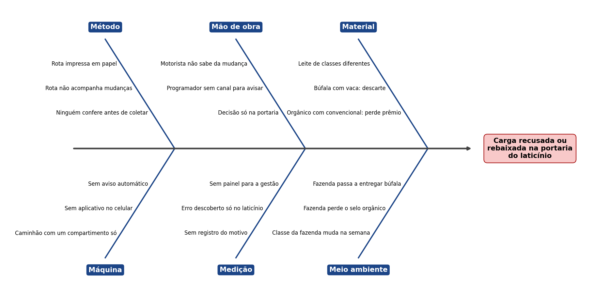
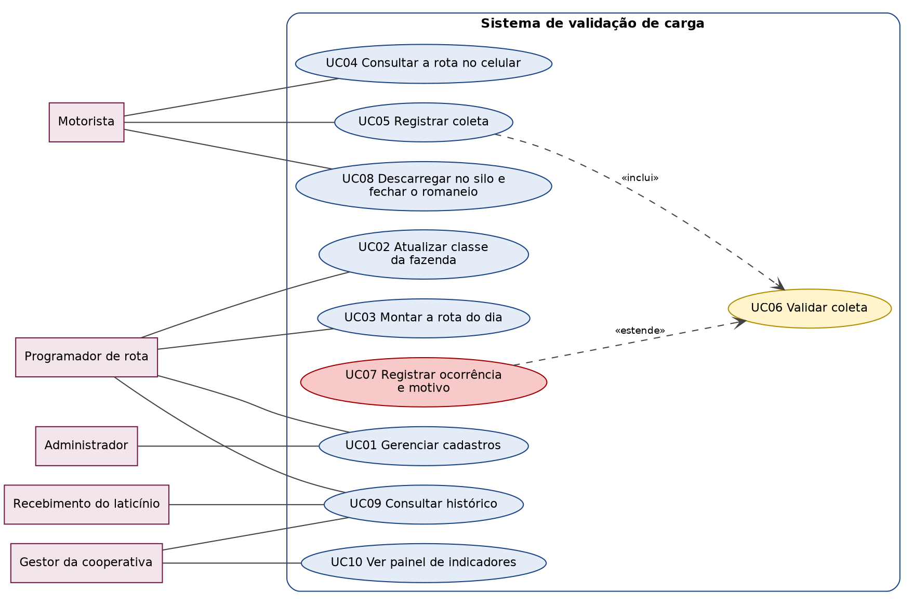
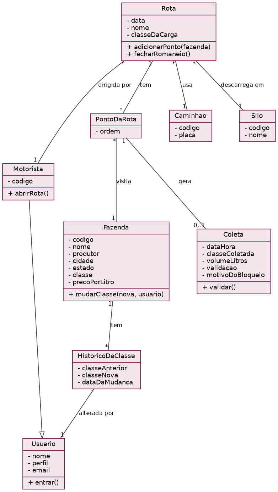

**Malu Sinal** (a vaca-semáforo): ela acende verde, amarelo ou vermelho antes da mistura, os mesmos três resultados da coleta (liberada, liberada com rebaixamento e bloqueada), para o motorista saber na hora se pode seguir. Bordão: "Eu cuido do sinal, você cuida da entrega!"

# Romaneio e validação de carga

**A3 de Projeto e Engenharia de Software · Grupo 5**

Integrantes: Warley Rocha Santos (RA 62621862), Kauã Gabriel Lopes Catrinck (RA 62613491), João Victor de Melo Costa (RA 62612967) e Marcus de Moraes Oliveira (RA 62611905).

> **Situação deste documento: rascunho.** Os requisitos abaixo saíram do enunciado e dos dados. Eles ainda precisam ser confirmados com o professor (o cliente) na aula de levantamento de requisitos. As partes marcadas com **[confirmar]** dependem dessa conversa.

---

# P — Plan (o problema)

## 1. O problema

Uma cooperativa de leite recolhe o leite de várias fazendas com um caminhão que tem **um compartimento só**. Tudo o que entra se mistura. Isso cria duas regras que custam caro:

- **Espécies diferentes** na mesma carga (leite de búfala com leite de vaca): a carga inteira é descartada.
- **Orgânico com convencional:** não descarta, mas o leite orgânico perde o prêmio e é pago como convencional.

A rota do dia já sai separada por classe de leite, mas **sai impressa em papel**. Se uma fazenda mudou de classe na semana anterior (perdeu a certificação orgânica, passou a entregar búfala), o motorista não fica sabendo e segue a sequência que está na mão. Ele só descobre o erro **na portaria do laticínio, com o caminhão cheio**.

O programador de rota resume: a informação existe, só não está com quem está dirigindo.

**O que o sistema precisa fazer:** montar a rota do dia com os pontos em ordem, bloquear a coleta que não pode ser misturada e registrar o que foi bloqueado e por quê.

## 2. Diagrama de Ishikawa (causas do problema)

Problema no centro: **carga recusada ou rebaixada na portaria do laticínio**. As causas vieram do enunciado. **[confirmar]** com o cliente se há outras.

## 3. SWOT

| | Ajuda | Atrapalha |
|---|---|---|
| **Interno** | **Forças:** a informação da classe de cada fazenda já existe; a rota já sai separada por classe; a cooperativa funciona; há seis meses de dados para analisar | **Fraquezas:** rota em papel; nada é registrado; ninguém reconstrói o que aconteceu; não existe sistema |
| **Externo** | **Oportunidades:** avisar o motorista no ponto de coleta; reduzir descarte e perda de prêmio; já existem aplicativos de coleta de leite no mercado, o que mostra que a ideia é viável | **Ameaças:** a classe da fazenda muda na semana e o cadastro pode ficar desatualizado; o motorista pode resistir a trocar o papel pelo celular; sinal de internet no campo **[confirmar]**; custo de licença para compartilhar o painel |

## 4. Requisitos

### Requisitos funcionais

| Código | O sistema deve | Caso de uso |
|---|---|---|
| RF01 | Cadastrar fazendas com produtor, cidade, estado, classe de leite (convencional, orgânico ou búfala) e preço por litro | UC01 |
| RF02 | Cadastrar caminhões, motoristas, silos e rotas | UC01 |
| RF03 | Alterar a classe de uma fazenda guardando a classe anterior, a data da mudança e quem alterou | UC02 |
| RF04 | Montar a rota do dia com os pontos em ordem, separada por classe de leite | UC03 |
| RF05 | Mostrar a rota do dia no celular do motorista, sempre com o cadastro mais recente | UC04 |
| RF06 | Registrar a coleta em cada ponto: classe coletada, volume, data e hora | UC05 |
| RF07 | Bloquear a coleta quando a espécie for diferente da que já está no caminhão e avisar o motorista na hora | UC06 |
| RF08 | Alertar quando houver mistura de orgânico com convencional (perda do prêmio) **[confirmar: bloquear ou só alertar?]** | UC06 |
| RF09 | Registrar cada bloqueio ou alerta com o motivo, a fazenda, a rota, o motorista e a data | UC07 |
| RF10 | Registrar a descarga no silo e fechar o romaneio do dia | UC08 |
| RF11 | Consultar o histórico de ocorrências por data, rota, motorista, caminhão, silo e fazenda | UC09 |
| RF12 | Mostrar um painel com os indicadores da seção C | UC10 |
| RF13 | Cadastrar usuários e perfis de acesso | UC01 |

### Requisitos não funcionais

| Código | Requisito |
|---|---|
| RNF01 | O aviso de bloqueio deve aparecer no momento do registro, sem o motorista precisar esperar |
| RNF02 | O registro de ocorrências não pode ser apagado, para permitir reconstruir o que aconteceu |
| RNF03 | A tela do motorista deve ser simples, com poucos toques por coleta |
| RNF04 | Cada usuário vê só o que o seu perfil permite, e os dados de motoristas e produtores seguem a LGPD |
| RNF05 | O aplicativo deve funcionar onde o sinal de internet é fraco **[confirmar]** |

### Perguntas para o cliente (aula de requisitos)

1. Orgânico com convencional: o sistema bloqueia ou só alerta e deixa o motorista decidir?
2. Quando a coleta é bloqueada, o que o motorista faz com o leite daquela fazenda?
3. Quem é responsável por avisar mudanças de classe: o programador de rota, a qualidade ou o técnico?
4. Como se calcula o prêmio perdido do orgânico rebaixado (diferença de preço por litro)?
5. Há sinal de internet em toda a rota? O aplicativo precisa funcionar sem sinal?
6. A portaria do laticínio e o produtor devem ter acesso ao sistema?
7. A ordem dos pontos da rota é sempre a mesma, ou muda no dia?
8. Qual a quantidade de caminhões, rotas e fazendas que o sistema deve suportar?

---

# D — Do (a solução desenhada)

## 5. Diagrama de casos de uso

| Caso de uso | Quem usa | Requisitos |
|---|---|---|
| UC01 Gerenciar cadastros | Programador de rota, administrador | RF01, RF02, RF13 |
| UC02 Atualizar classe da fazenda | Programador de rota | RF03 |
| UC03 Montar a rota do dia | Programador de rota | RF04 |
| UC04 Consultar a rota no celular | Motorista | RF05 |
| UC05 Registrar coleta | Motorista | RF06 |
| UC06 Validar coleta (incluído no UC05) | Sistema | RF07, RF08 |
| UC07 Registrar ocorrência e motivo (estende o UC06) | Sistema | RF09 |
| UC08 Descarregar no silo e fechar o romaneio | Motorista | RF10 |
| UC09 Consultar histórico | Programador, gestor, recebimento | RF11 |
| UC10 Ver painel de indicadores | Gestor | RF12 |

## 6. Diagrama de classes

| Classe | Para que serve | Requisitos |
|---|---|---|
| Fazenda | Guarda os dados e a classe atual de cada fazenda | RF01, RF03 |
| HistoricoDeClasse | Guarda cada mudança de classe, com data e autor | RF03 |
| Usuario e Motorista | Quem acessa o sistema e quem dirige a rota | RF02, RF13 |
| Rota e PontoDaRota | A rota do dia e a ordem das fazendas visitadas | RF04, RF05 |
| Caminhao e Silo | Onde o leite é carregado e descarregado | RF02, RF10 |
| Coleta | Cada coleta, com o resultado da validação e o motivo do bloqueio | RF06 a RF09 |

---

# C — Check (o painel)

O painel será feito no Power BI com os dois arquivos relacionados pela coluna `fazenda_id` (`fazendas.csv` e `romaneio.csv`). Os números abaixo já foram calculados a partir dos arquivos e servem para conferir o painel depois de pronto.

**Base:** 40 fazendas e 1.092 coletas, de 01/09/2025 a 28/02/2026, em 3 rotas, 3 caminhões, 4 motoristas e 3 silos. Volume total: 1.485.037 litros.

| # | Indicador | O que mostra | Valor na base |
|---|---|---|---|
| 1 | Total de coletas e volume | Tamanho da operação | 1.092 coletas e 1.485.037 L |
| 2 | Coletas liberadas, bloqueadas e liberadas com rebaixamento | Quanto da operação dá problema | 1.028 (94,1%), 36 (3,3%) e 28 (2,6%) |
| 3 | Litros descartados | Perda por espécie diferente | 49.742 L |
| 4 | Litros rebaixados | Orgânico pago como convencional | 39.488 L |
| 5 | Coletas com classe diferente do cadastro | Mudanças de classe que o motorista não soube | 28 (usa as duas tabelas) |
| 6 | Ocorrências por motivo | Qual regra é mais quebrada | 36 espécie diferente e 28 orgânico com convencional |
| 7 | Ocorrências por rota | Rotas mais críticas | R1: 12, R2: 29, R3: 23 |
| 8 | Ocorrências por motorista | Onde reforçar o aviso | Aparecido Nunes: 14 de 364 · Djalma Souto: 9 de 184 · Everaldo Pires: 21 de 364 · Milton Gouveia: 20 de 180 |
| 9 | Ocorrências por silo | Onde chegam as cargas com problema | Silo A: 18, B: 23, C: 23 |
| 10 | Ocorrências por mês | Tendência | set: 12 · out: 15 · nov: 5 · dez: 11 · jan: 15 · fev: 6 |
| 11 | Fazendas com mais ocorrências | Fazendas para acompanhar | F028 e F029: 5 cada · F025: 4 |

Prêmio perdido em reais (litros rebaixados vezes a diferença de preço): **[confirmar a regra com o cliente]**.

**O que o painel mostra até aqui:** cerca de 5,9% das coletas (64 de 1.092) terminaram bloqueadas ou rebaixadas, somando 89.230 litros. Em 28 coletas a classe coletada era diferente da classe cadastrada. Os números por motorista não provam culpa, já que a rota e o tipo de fazenda também pesam.

> **Falta fazer:** montar o `relatorio.pbix`, exportar o `relatorio.pdf` e conferir que os valores do painel batem com a tabela acima.

---

# A — Act (o que ficou faltando)

_Esta parte deve ser atualizada no fim do trabalho. Por enquanto, o que já sabemos:_

- **Não deu tempo / ainda falta:** conversar com o cliente para confirmar os requisitos; montar o painel no Power BI; definir o mascote.
- **Ficou frágil:** os requisitos foram escritos a partir do enunciado e dos dados, não de perguntas feitas ao cliente; a regra do prêmio perdido ainda não existe; não sabemos se há sinal de internet em toda a rota.
- **O que faríamos diferente:** começar pelo caso de uso mais usado (registrar e validar a coleta) e fazer as perguntas ao cliente antes de desenhar as classes.
